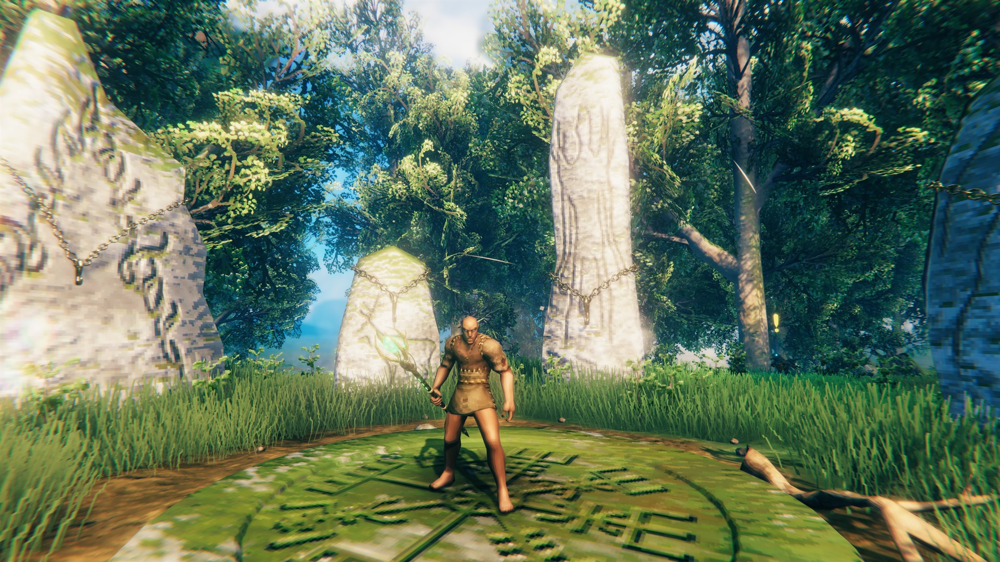
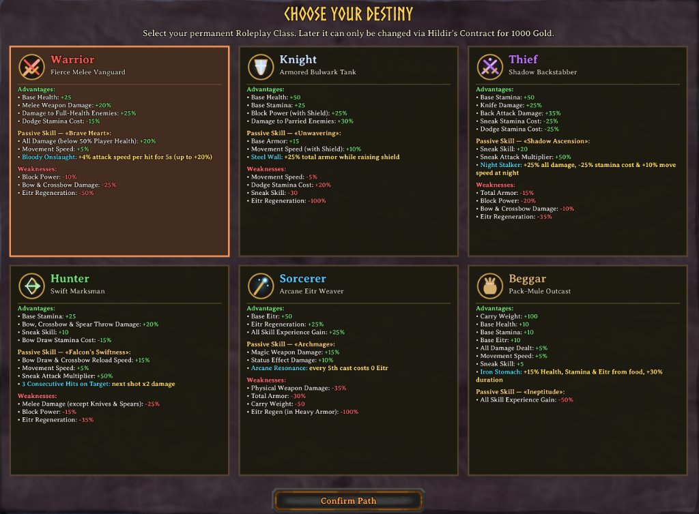
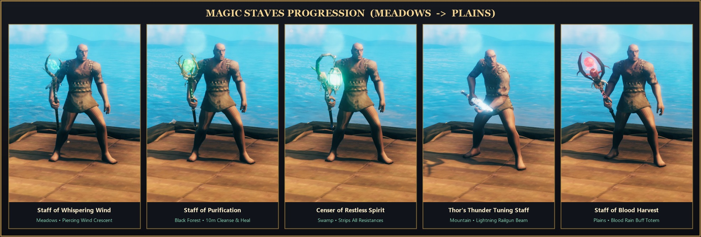
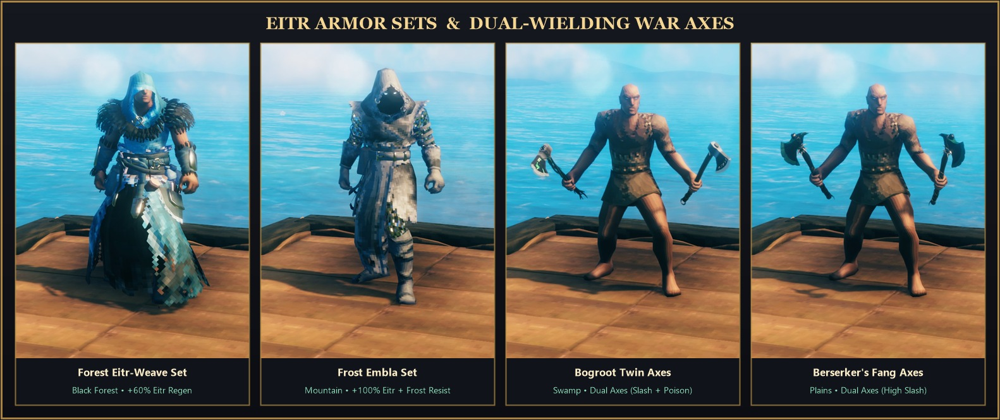
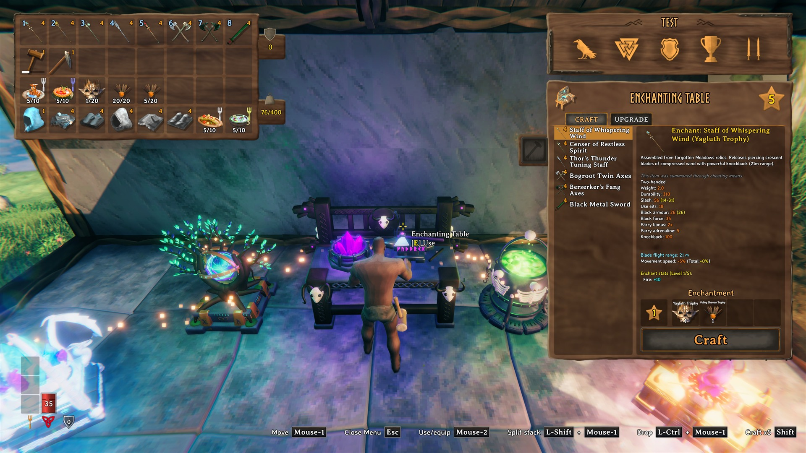

# ⚔️ Valheim — Path of the Fallen

**[ 🇬🇧 English Description ](#-english-overview) | [ 🇷🇺 Описание на русском ](#-описание-на-русском) | [ ⌨️ ID & Команды / Prefab IDs ](#-консольные-команды-и-id-предметов) | [ 💻 GitHub ](https://github.com/Coarstal/PathOfTheFallen)**

  

---

## 🇬🇧 English Overview

> **Valheim — Path of the Fallen** is a comprehensive, modular action-RPG overhaul by **Coarstal** built for solo play and multiplayer servers. Choose one of **6 Roleplay Classes**, unlock full **Mage progression starting right in the Meadows** (5 custom 3D Staves, Dual Axes, pre-Mistlands Eitr Armor & 6 Eitr Foods), infuse **7 Forsaken Boss Souls** into your weapons at a custom 3D Enchanting Table, and survive a deadlier Tenth World featuring **Named Hunt Champions**, **6 Tactical Combat Injuries**, **Sealed Cursed Dungeons**, and **organic boss hunting without Vegvisirs**.

Every single module can be toggled independently in `[00. Modules]`, and over **150 balance & recipe settings** synchronize automatically from server to clients!

---

### 🎭 1. Six Fates — Roleplay Class System (`RP Classes`)
Upon entering the world, choose your Viking's destiny — complete with innate stat pools, unique combat passives, live HUD stack indicators, and overhead multiplayer class tags:

  

| Class | Playstyle & Strengths | Signature Passive | Drawbacks |
| :--- | :--- | :--- | :--- |
| **Warrior** | `+25` HP, `+20%` Melee dmg, `+25%` vs Full-HP foes, `-15%` Dodge stamina | **Brave Heart:** `+20%` all dmg below `50%` HP, `+5%` speed, stacking **Bloody Onslaught** (`+4%` attack speed & `+2.5%` lifesteal per hit up to `+20%` / `12.5%`) | `-10%` Block power, `-25%` Bow/Crossbow dmg, `-50%` Eitr regen |
| **Knight** | `+50` HP, `+25` Stamina, `+25%` Shield block power, `+30%` Parry riposte dmg | **Unwavering:** `+15` flat Armor, `+10%` move speed with shield, **Steel Bulwark** (`+25%` total armor while blocking) | `-5%` move speed, `+20%` Dodge stamina, `-30` Sneak, `-100%` Eitr regen |
| **Thief** | `+50` Stamina, `+25%` Knife dmg, `+35%` Combat backstab, `-25%` Sneak & Dodge stamina | **Shadow Ascension:** `+20` Sneak, `+50%` sneak backstab, **Shroud of Night** (`+25%` all dmg, `-25%` stamina use & `+10%` run speed at night) | `-15%` Armor, `-20%` Block power, `-10%` Ranged dmg, `-35%` Eitr regen |
| **Hunter** | `+25` Stamina, `+20%` Bow/Crossbow/Spear dmg, `+10` Sneak, `-15%` Bow draw stamina | **Falcon's Finesse:** `+15%` Draw/Reload speed, `+5%` move speed, `+50%` sneak bonus, **3 consecutive hits empower the 4th shot for `x2` damage** | `-25%` Melee dmg (except knives & spears), `-15%` Block power, `-35%` Eitr regen |
| **Sorcerer** | `+50` Base Eitr, `+25%` Eitr regen, `+25%` Skill XP gain | **Archmage:** `+50%` Forsaken Power duration (`7.5 min` for whole party), `-25%` Forsaken Power cooldown (`15 min`), **Arcane Flow** (**every 5th spell cast/charge costs `0` Eitr**) | `-35%` Physical weapon dmg, `-30%` Armor, `-50` Carry weight, `0` Eitr regen in Heavy Armor |
| **Beggar** | `+100` Carry weight, `+10` Base HP/Stamina/Eitr, `+5%` all dmg & move speed, `+5` Sneak | **Iron Stomach & Ineptitude:** `+15%` HP/Stamina/Eitr from all foods & `+30%` food duration; `-50%` Skill XP gain | Slower skill leveling |

- **Class Respec:** Purchase the **Scroll of Rebirth** from **Hildir** for `1000 Coins` and right-click it in your inventory.

---

### 🪄 2. Early-to-Late Magic, Dual Axes & Eitr Cuisine (`Weapon Pack` & `Eitr Armor`)
No more waiting until Mistlands to play a mage, healer, or dual-wielding berserker:

#### Five Custom 3D Magic Staves (Meadows → Plains)

  

1. **Staff of Whispering Wind** (`StaffMeadows`, *Meadows — Elemental Magic*): Assembled at a Workbench from 3 forgotten relics found in abandoned Meadows chests (`PartWindCrystal`, `PartCarvedHandle`, `PartRunicBinding`), and **upgraded exclusively at the Forge of Potential**. Fires piercing wind crescents (`25` Slash dmg `+15` per level, `100` knockback, `21m` range).
2. **Staff of Purification** (`StaffBlackForest`, *Black Forest — Blood Magic*): Crowned with a glowing shamanic emerald crystal (`50` Eitr, `0%` HP cost). Releases a `10m` healing wave that **cleanses all 6 Combat Injuries and negative debuffs** (*Burning, Poison, Frost, Tar, Lightning, Wet*) **before restoring `+30 / +40 / +50 / +60 HP`** by staff level (`x1.5` stronger — `+45 / +60 / +75 / +90 HP` — inside the Blood Totem's field!).
3. **Censer of Restless Spirit** (`StaffSwamp`, *Swamp — Elemental Magic*): Detonates an `8s` spirit miasma cloud dealing `5` Poison + `5` Spirit damage (`+5 / +5` per level) once every **`2s`**, **slowing enemy movement by `20%`**, and **stripping ALL damage resistances and immunities** from enemies and bosses inside.
4. **Thor's Thunder Tuning Staff** (`StaffMountain`, *Mountain — Elemental Magic*): Hold-to-charge lightning railgun (`150 / 300 / 450 / 600` Lightning damage) firing an instant piercing beam through enemies, trees, and structures.
5. **Staff of Blood Harvest** (`StaffPlains`, *Plains — Blood Magic*): Fixed `75` Eitr & `50` HP cost. Deploys a **permanent** 3D Blood Ritual Totem (max `1` active totem, replaced on recast) summoning an endless crimson rainstorm: slows enemies by `40%`, amplifies **Staff of Purification** healing by **`x1.5`**, and grants allies `+10%` move speed, `+50%` HP & Eitr regen, and `-30%` to all stamina/eitr/health action costs (buff lingers for **`5s`** after leaving the field).

#### Dual-Wielding War Axes

  

- **Bogroot Twin Axes** (`AxeDualSwamp`) — Swamp Forge Lvl 2 (`Slash + Poison`).
- **Berserker's Fang Axes** (`AxeDualPlains`) — Plains Forge Lvl 4 (`High Slash`).

#### Pre-Mistlands Mage Eitr Armor Sets
- **Forest Eitr-Weave Set** (*Black Forest, Forge Lvl 1*): Hood, Robe & Trousers (`+60%` Total Eitr Regen with 3/3 Set Bonus, `0%` movement penalty).
- **Frost Embla Set** (*Mountains, Forge Lvl 2*): Hood, Robes & Trousers (`+100%` Total Eitr Regen with 3/3 Set Bonus + built-in **Frost Resistance**).

#### Six Eitr Foods (with Serving Tray Support)
- **Grilled Neck Tail** & **Yellow Mushroom** boosted with `+25` Eitr, plus 4 custom 3D cauldron dishes: **Mushroom-Stuffed Neck Tail** (`40` Eitr), **Necromancer's Brew** (`50` Eitr), **Story of the Sad Aufer** (`30/30/30`), and **Plains Shaman Tart** (`65` Eitr).

---

### 🔥 3. Boss Soul Weapon Enchanting (`Weapon Attributes`)
Build the custom 3D **Enchanting Table** (`piece_enchanting_table`) and upgrade it from Level 1 to Level 5 with **4 animated Boss Extensions** (*Elder's Root Totem*, *Bonemass Poison Urn*, *Moder's Crystal Altar*, *Yagluth's Eternal Flame*):

  

  

- Infuse swords, maces, axes, polearms, bows, and offensive staves with **7 Forsaken Boss Souls** across **Tiers I–V** (`+10` to `+50` elemental/physical bonus damage):
  - **Eikthyr:** Lightning ⚡ | **The Elder:** Physical 🪵 | **Bonemass:** Poison 🧪 | **Moder:** Frost ❄️ | **Yagluth:** Fire 🔥 | **The Queen:** Poison + Lightning 🟣 | **Fader:** Fire + Spirit 🔥✨
- Unlock Tier I with `1 Boss Trophy + 1 Biome Mob Trophy`, and upgrade Tiers II–V using matching mob trophies (`5 / 10 / 15 / 20`).

---

### ☠️ 4. Hunt Champions, 6 Combat Injuries & Cursed Dungeons (`Enemy Overhaul`)
- **Named Hunt Champions (Biome Vendetta):** Every **~25–35 slain enemies** across all species, a **Named Champion** of the **exact creature killed last** ambushes the hunter with 2-star base stats (`3.0x` HP, `2.0x` dmg) **plus guaranteed biome elemental attacks** (*toxin/poison, frost, fire, lightning*), combat perks, and stagger resistance — dropping **guaranteed trophies** and **bonus Coins**.
- **6 Tactical Combat Injuries:** Unblocked enemy hits dealing at least **`7.5` HP damage** can inflict *Bleeding* (`x2` bleed damage while sprinting/rolling!), *Hamstrung* (`-25%` speed), *Sundered Armor* (`-30%` armor), *Winded* (`-50%` stamina regen), *Eitr Burn* (casting burns HP), or *Putrid Rot* (`-50%` healing — countered by the *Staff of Purification*!).
- **Sealed Cursed Dungeons (`10%` of each dungeon type):** Strictly `10%` of each multi-room dungeon type (*Burial Chambers, Sunken Crypts, Frost Caves, Infested Mines, Morgen Caves, Charred Tombs*; Troll & Bear caves excluded) are cursed: stepping inside triggers mystical fog, buffs monsters (`+30%` HP & dmg), and **seals the exit shut** until your party slays the **Curse Warden** in the deepest chamber.

---

### 🧭 5. Organic Exploration (`No Vegvisir`)
Removes boss **Vegvisir** runestones from the overworld and dungeons (or optionally leaves them as non-interactive lore stones), turning boss altar hunting into a true expedition.

---

### ⚙️ Installation & Configuration
1. Install **BepInExPack Valheim** and **Jötunn**.
2. Install **Path of the Fallen** via Thunderstore Mod Manager / r2modman (or extract `PathOfTheFallen.dll` into `BepInEx/plugins/`).
3. Configure any module or stat in `BepInEx/config/com.coarstal.pathofthefallen.cfg`.

### ⌨️ Console Commands & Prefab IDs (EN)
> Press `F5` and enter `devcommands`. Spawn items with: **`spawn <PrefabID> [amount] [quality_level]`** *(e.g. `spawn StaffBlackForest 1 4`)*.

#### Admin Commands
| Command | Effect |
| :--- | :--- |
| `rpclass` *(or `rpclass ui`)* | Open the Class Selection UI manually |
| `rpclass reset` | Clear your current class and open the initial selection screen |
| `rpclass set <warrior\|knight\|thief\|hunter\|sorcerer\|beggar>` | Instantly assign a class (`1..6` also supported) |
| `enemyoverhaul champion [PrefabName]` | Spawn a stalking Hunt Champion nearby *(e.g. `Troll`, `Draugr`, `Goblin`, `Wolf`, `SeekerBrute`)* |
| `enemyoverhaul kills [number]` | Check (or set) the global Hunt Champion kill counter (`25–35` kills) |
| `enemyoverhaul injury <bleed\|hamstring\|sunder\|winded\|eitrburn\|rot\|all\|clear>` | Inflict or cleanse Combat Injuries (`15m` AoE on `clear`) |
| `enemyoverhaul map` / `enemyoverhaul map clear` | Show or clear map pins for all active **Cursed Dungeons** |
| `enemyoverhaul cursedungeon` / `enemyoverhaul uncurse` | Force-curse & seal (or unseal) the nearest/current dungeon |
| `enemyoverhaul status` | Print debug status of the current dungeon |

#### All Item & Building Prefab IDs
| Prefab ID | Item / Piece Name | Category |
| :--- | :--- | :--- |
| `AxeDualSwamp` | Bogroot Twin Axes | Swamp Dual Axes (Lvl 1–4) |
| `AxeDualPlains` | Berserker's Fang Axes | Plains Dual Axes (Lvl 1–4) |
| `StaffMeadows` | Staff of Whispering Wind | Meadows Staff (Lvl 1–4) |
| `StaffBlackForest` | Staff of Purification | Black Forest AoE Cleanse & Heal Staff (Lvl 1–4) |
| `StaffSwamp` | Censer of Restless Spirit | Swamp Resistance-Strip Staff (Lvl 1–4) |
| `StaffMountain` | Thor's Thunder Tuning Staff | Mountain Lightning Railgun (Lvl 1–4) |
| `StaffPlains` | Staff of Blood Harvest | Plains Permanent Blood Totem Staff |
| `PartWindCrystal` / `PartCarvedHandle` / `PartRunicBinding` | Whispering Wind Relic Parts | Meadows Chest Relics |
| `ArmorForestShamanHood` / `ArmorForestShamanChest` / `ArmorForestShamanLegs` | Forest Eitr-Weave Set | Black Forest Mage Armor (`+60%` Eitr Regen) |
| `ArmorWolfMageHood` / `ArmorWolfMageChest` / `ArmorWolfMageLegs` | Frost Embla Set | Mountain Mage Armor (`+100%` Eitr Regen + Frost Resist) |
| `FoodStuffedNeck` / `FoodNecroSoup` / `FoodSadAufer` / `FoodPlainsTart` | Custom Eitr Dishes | Cauldron Lvl 1–4 Eitr Foods |
| `Piece_FoodStuffedNeck` / `Piece_FoodNecroSoup` / `Piece_FoodSadAufer` / `Piece_FoodPlainsTart` | Table Feast Pieces | Serving Tray Placeables |
| `RebirthScroll` | Scroll of Rebirth | Class Respec Consumable (also sold by Hildir for `1000` Coins) |
| `piece_enchanting_table` | Enchanting Table | Boss Soul Enchanting Station (Base Lvl 1) |
| `piece_enchant_ext_elder` / `piece_enchant_ext_bonemass` / `piece_enchant_ext_moder` / `piece_enchant_ext_yagluth` | Station Extensions (`+1` Lvl each) | Upgrades Enchanting Table up to Lvl 5 |

---
---

## 🇷🇺 Описание на русском

> **Valheim — Path of the Fallen *(Путь Павших)*** — масштабный модульный RPG-оверхол для **Valheim** от **Coarstal**, превращающий выживание в глубокую кооперативную экшен-RPG. Выберите один из **6 ролевых классов**, откройте полноценный путь мага с самых **Лугов** (5 уникальных посохов, парные топоры, ранняя Эйтр-броня и кулинария), вплетайте **души 7 боссов** в оружие на кастомном Столе зачарования и бросьте вызов опасному миру: с **Именными Чемпионами Охоты**, **6 боевыми травмами**, **запечатанными Проклятыми подземельями** и честным поиском алтарей **без камней-вегвизиров**.

Любой из 6 модулей можно независимо включить или отключить в секции `[00. Modules]`, а более **150 параметров баланса и рецептов** автоматически синхронизируются между сервером и клиентами!

---

### 🎭 1. Шесть судеб — ролевая система классов (`RP Classes`)
При первом входе в мир выберите своё призвание со своими пулами здоровья/выносливости/эйтра, боевыми пассивками, счётчиками стаков на HUD и отображением класса над ником в кооперативе:

  

| Класс | Преимущества | Пассивный навык | Недостатки |
| :--- | :--- | :--- | :--- |
| **Воин** | `+25` HP, `+20%` урона вблизи, `+25%` по целям с полным HP, `-15%` выносливости на перекат | **Храброе сердце:** `+20%` всего урона при `<50%` HP, `+5%` скорости, стаки **Кровавого натиска** (`+4%` скорости атаки и `+2,5%` вампиризма за удар, до `+20%` / `12,5%`) | `-10%` силы блока, `-25%` урона луками/арбалетами, `-50%` регена Эйтра |
| **Рыцарь** | `+50` HP, `+25` выносливости, `+25%` блока щитом, `+30%` урона по спарированным врагам | **Непоколебимость:** `+15` базовой брони, `+10%` скорости со щитом, **Стальной заслон** (`+25%` к общей броне при поднятом щите) | `-5%` скорости, `+20%` цены переката, `-30` скрытности, `-100%` регена Эйтра |
| **Вор** | `+50` выносливости, `+25%` урона ножами, `+35%` урона в спину в бою, `-25%` затрат скрытности и переката | **Восхождение в тени:** `+20` скрытности, `+50%` внезапной атаки, **Покров ночи** (`+25%` урона, `-25%` расхода стамины и `+10%` бега ночью) | `-15%` брони, `-20%` силы блока, `-10%` стрелкового урона, `-35%` регена Эйтра |
| **Охотник** | `+25` выносливости, `+20%` урона луками/арбалетами/копьями, `+10` скрытности, `-15%` натяжения тетивы | **Соколиная сноровка:** `+15%` скорости стрельбы, `+5%` бега, `+50%` внезапной атаки, **после 3 попаданий подряд 4-й выстрел наносит `x2` урона** | `-25%` ближнего урона (кроме ножей и копий), `-15%` блока, `-35%` регена Эйтра |
| **Колдун** | `+50` базового Эйтра, `+25%` регена Эйтра, `+25%` опыта навыков | **Архимаг:** `+50%` длительности Силы Павших (`7,5 мин.` на всех союзников), `-25%` перезарядки Силы Павших (`15 мин.`), **Поток магии** (**каждый 5-й каст/заряд бесплатный по Эйтру**) | `-35%` физ. оружием, `-30%` брони, `-50` веса, `0` регена Эйтра в тяжёлой броне |
| **Нищий** | `+100` переносимого веса, `+10` HP/стамины/Эйтра, `+5%` урона и бега, `+5` скрытности | **Лужёный желудок и Бездарность:** `+15%` характеристик от любой еды и `+30%` длительности сытости; `-50%` опыта навыков | Медленная прокачка навыков |

- **Смена класса:** купите **«Свиток Перерождения»** у **Хильдир** за `1000 монет` и нажмите по нему ПКМ в инвентаре.

---

### 🪄 2. Магия с первых шагов, парные топоры и кулинария Эйтра (`Weapon Pack` и `Eitr Armor`)
Играйте за мага, целителя отряда или берсерка с самого начала прохождения:

#### 5 уникальных магических посохов (Луга → Равнины)

  

1. **Посох Шепчущего Ветра** (`StaffMeadows`, *Луга — Магия стихий*): собирается на верстаке из 3 забытых реликвий в сундуках заброшенных построек Лугов и **прокачивается исключительно в Кузнице возможностей**; выпускает пронзающие серпы сжатого ветра (`25` рассекающего урона `+15` за каждый уровень, отбрасывание `100`, дальность `21 м`).
2. **Посох Очищения** (`StaffBlackForest`, *Чёрный лес — Магия крови*): шаманский посох с изумрудным кристаллом (`50` Эйтра, `0%` траты HP). Испускает целебную волну радиусом `10 м`, которая **сперва снимает все 6 Боевых Травм и негативные эффекты** (*Горение, Яд, Иней, Смолу, Молнию, Промокание*), **а затем лечит всех союзников в круге на `+30 / +40 / +50 / +60 HP`** по уровню посоха (в поле Кровавого Тотема — **`x1,5`**, т.е. `+45 / +60 / +75 / +90 HP`!).
3. **Кадило Беспокойного Духа** (`StaffSwamp`, *Болота — Магия стихий*): взрывает облако миазмов на `8 сек.`, наносящее `5` урона ядом и `5` духом (`+5 / +5` за каждый уровень) **каждые `2 сек.`**, **замедляющее бег врагов на `20%`** и **полностью срывающее любые сопротивления и иммунитеты** у врагов и боссов.
4. **Громовой Камертон Тора** (`StaffMountain`, *Горы — Магия стихий*): заряжаемый молниевый рельсотрон (`150 / 300 / 450 / 600` урона молнией), прошивающий врагов, деревья и постройки навылет.
5. **Посох Кровавой Жатвы** (`StaffPlains`, *Равнины — Магия крови*): стабильный расход `75` Эйтра и `50` HP. Устанавливает **бесконечный** 3D-тотем кровавого дождя (лимит: `1` активный тотем, переставляется новым кастом): замедляет врагов на `40%`, усиливает исцеление **Посоха Очищения** в **`1,5` раза**, а игрокам даёт `+10%` скорости, `+50%` регенерации HP и Эйтра и `-30%` ко всем затратам (при выходе из поля бафф действует ещё **`5 сек.`**).

#### Парные секиры, Эйтр-броня и 6 блюд на Эйтр

  

- **Парные топоры:** ядовитые *Корнерубы Топей* (`AxeDualSwamp`) и *Клыкастые Топоры Берсерка* (`AxeDualPlains`).
- **Магическая броня до Туманных земель:** *Лесной сет эйтра* (Чёрный лес, `+60%` регена Эйтра за 3/3) и *Горный сет Эмблы* (Горы, `+100%` регена Эйтра за 3/3 + **защита от мороза**).
- **6 блюд на Эйтр (с поддержкой сервировочного подноса):** *Жареный хвост никса* и *Жёлтый гриб* (`+25` Эйтра), *Фаршированный хвост никса* (`40` Эйтра), *Отвар некроманта* (`50` Эйтра), *История грустного ауфера* (`30/30/30`) и *Тарт шамана Равнин* (`65` Эйтра).

---

### 🔥 3. Зачарование оружия душами боссов (`Weapon Attributes`)
Постройте **Стол зачарования** (`piece_enchanting_table`) и улучшите его с 1 до 5 уровня **4 анимированными алтарями боссов** (*Корневой тотем Древнего*, *Ядовитая урна Массы Костей*, *Кристальный алтарь Моудер*, *Вечное пламя Яглута*):

  

  

- Наделите оружие силой любого из **7 боссов Вальхейма** и прокачайте чары с **I по V уровень** (`+10..+50` бонусного урона с цветной меткой заточки на иконке):
  - **Эйктюр:** Молния ⚡ | **Древний:** Физ. урон 🪵 | **Масса Костей:** Яд 🧪 | **Моудер:** Мороз ❄️ | **Яглут:** Огонь 🔥 | **Королева:** Яд + Молния 🟣 | **Фадер:** Огонь + Дух 🔥✨

---

### ☠️ 4. Чемпионы Охоты, 6 Боевых Травм и Проклятые Данжи (`Enemy Overhaul`)
- **Именные Чемпионы Охоты:** каждые **~25–35 убитых врагов** (единый счётчик на всех мобов) по следу охотника выходит **Чемпион — того вида моба, который был убит последним**, с базовыми характеристиками `2★` (`3.0x` HP, `2.0x` урона) и **гарантированным стихийным уроном своего биома** (*токсином/ядом, морозом, огнём или молнией*) + боевыми перками. За победу — **100% гарантированный дроп трофеев** и **монеты**.
- **6 Боевых Травм:** незаблокированные удары врагов (наносящие минимум **`7.5` ед. урона** по здоровью) накладывают *Рваную рану* (на спринте и в перекатах урон крови `x2`!), *Простреленное сухожилие*, *Раскол брони*, *Выбитое дыхание*, *Ожог Эйтра* или *Заражение* (`-50%` любого лечения — снимается *Посохом Очищения*!).
- **Запечатанные Проклятые Данжи (`10%` от каждого типа):** ровно `10%` многокомнатных подземелий каждого типа в мире (*Курганы, Затопленные склепы, Морозные пещеры, Заражённые шахты, Пещеры Моргена и Гробницы*; пещеры тролля и медведя исключены) оказываются прокляты — внутри сгущается цветной туман, мобы получают `+30%` к HP и урону, а **выход наружу запечатывается**, пока не повержен **Страж Проклятия** в дальней комнате.

---

### 🧭 5. Мир без подсказок (`No Vegvisir`)
Удаляет все **камни-вегвизиры** из мира и подземелий, возвращая азарт настоящих поисковых экспедиций за алтарями Павших.

---

### ⚙️ Установка и настройка
1. Установите **BepInExPack Valheim** и **Jötunn**.
2. Установите **Path of the Fallen** через Thunderstore Mod Manager / r2modman (или поместите `PathOfTheFallen.dll` в `BepInEx/plugins/`).
3. Файл конфигурации: `BepInEx/config/com.coarstal.pathofthefallen.cfg`.

---

### ⌨️ Консольные команды и ID предметов
> Откройте консоль (`F5`) и введите `devcommands`. Для выдачи любого предмета: **`spawn <ID> [количество] [уровень]`** *(например: `spawn StaffBlackForest 1 4`)*.

#### Управление классом (`RP Classes`)
| Команда | Описание |
| :--- | :--- |
| `rpclass` *(или `rpclass ui`)* | Открыть окно выбора класса вручную |
| `rpclass reset` | Сбросить текущий класс персонажа и открыть стартовый выбор |
| `rpclass set warrior` *(или `воин` / `1`)* | Назначить класс **Воин** |
| `rpclass set knight` *(или `рыцарь` / `2`)* | Назначить класс **Рыцарь** |
| `rpclass set thief` *(или `вор` / `3`)* | Назначить класс **Вор** |
| `rpclass set hunter` *(или `охотник` / `4`)* | Назначить класс **Охотник** |
| `rpclass set sorcerer` *(или `колдун` / `5`)* | Назначить класс **Колдун** |
| `rpclass set beggar` *(или `нищий` / `6`)* | Назначить класс **Нищий** |

#### Чемпионы, Травмы и Проклятые Данжи (`Enemy Overhaul`)
| Команда | Описание |
| :--- | :--- |
| `enemyoverhaul champion [PrefabName]` | Заспавнить рядом скрытого Чемпиона *(например: `Troll`, `Draugr`, `Goblin`, `Wolf`, `SeekerBrute`)* |
| `enemyoverhaul kills [число]` | Показать (или задать) общий счётчик убийств до появления Чемпиона (`25–35`) |
| `enemyoverhaul injury <bleed\|hamstring\|sunder\|winded\|eitrburn\|rot\|all>` | Наложить выбранную боевую травму (или все 6 сразу) |
| `enemyoverhaul injury clear` *(или `cleanse`)* | Снять все боевые травмы со всех игроков в радиусе `15 м` |
| `enemyoverhaul map` / `enemyoverhaul map clear` | Показать или убрать на карте метки всех активных **Проклятых подземелий** |
| `enemyoverhaul cursedungeon` / `enemyoverhaul uncurse` | Принудительно запечатать проклятием (или очистить) текущее подземелье |
| `enemyoverhaul status` | Показать статус и отладочную информацию текущего подземелья |

#### ID оружия, посохов и реликвий
| ID префаба | Название | Тип / Биом |
| :--- | :--- | :--- |
| `AxeDualSwamp` | Корнерубы Топей | Парные топоры (Болота, ур. 1–4) |
| `AxeDualPlains` | Клыкастые Топоры Берсерка | Парные топоры (Равнины, ур. 1–4) |
| `StaffMeadows` | Посох Шепчущего Ветра | Посох ветряных серпов (Луга, ур. 1–4) |
| `StaffBlackForest` | Посох Очищения | Посох снятия дебаффов и лечения (Чёрный лес, ур. 1–4) |
| `StaffSwamp` | Кадило Беспокойного Духа | Посох снятия сопротивлений (Болота, ур. 1–4) |
| `StaffMountain` | Громовой Камертон Тора | Молниевый рельсотрон (Горы, ур. 1–4) |
| `StaffPlains` | Посох Кровавой Жатвы | Посох бесконечного кровавого тотема (Равнины) |
| `PartWindCrystal` | Осколок Кристалла Ветра | Реликвия для крафта посоха Лугов |
| `PartCarvedHandle` | Резная Ясеневая Рукоять | Реликвия для крафта посоха Лугов |
| `PartRunicBinding` | Руническая Перевязь из Рога | Реликвия для крафта посоха Лугов |

#### ID брони, еды, свитка и построек
| ID префаба | Название | Назначение |
| :--- | :--- | :--- |
| `ArmorForestShamanHood` | Лесной капюшон эйтра | Сет Чёрного леса (`+60%` регена Эйтра за 3/3) |
| `ArmorForestShamanChest` | Лесное сшитое из эйтра одеяние | Сет Чёрного леса (`+60%` регена Эйтра за 3/3) |
| `ArmorForestShamanLegs` | Лесные штаны эйтра | Сет Чёрного леса (`+60%` регена Эйтра за 3/3) |
| `ArmorWolfMageHood` | Горный капюшон Эмблы | Сет Гор (`+100%` регена Эйтра за 3/3) |
| `ArmorWolfMageChest` | Горная одежда Эмблы | Сет Гор (`+100%` регена Эйтра + защита от мороза) |
| `ArmorWolfMageLegs` | Горные штаны Эмблы | Сет Гор (`+100%` регена Эйтра за 3/3) |
| `FoodStuffedNeck` | Фаршированный грибами хвост никса | Еда котла ур. 1 (`40` Эйтр / `15` HP / `20` Стамина) |
| `FoodNecroSoup` | Отвар некроманта | Еда котла ур. 2 (`50` Эйтр / `15` HP / `40` Стамина) |
| `FoodSadAufer` | История грустного ауфера | Еда котла ур. 3 (`30` Эйтр / `30` HP / `30` Стамина) |
| `FoodPlainsTart` | Тарт шамана Равнин | Еда котла ур. 4 (`65` Эйтр / `20` HP / `10` Стамина) |
| `Piece_FoodStuffedNeck` / `Piece_FoodNecroSoup` / `Piece_FoodSadAufer` / `Piece_FoodPlainsTart` | Сервировочные блюда на стол | Размещение через сервировочный поднос |
| `RebirthScroll` | Свиток Перерождения | Смена RP-класса (ПКМ в инвентаре / у Хильдир за `1000` монет) |
| `piece_enchanting_table` | Стол зачарования | Базовая станция зачарования оружия (Ур. 1) |
| `piece_enchant_ext_elder` | Корневой тотем Древнего | Улучшение Стола зачарования `+1` (до Ур. 2) |
| `piece_enchant_ext_bonemass` | Ядовитая урна Массы Костей | Улучшение Стола зачарования `+1` (до Ур. 3) |
| `piece_enchant_ext_moder` | Кристальный алтарь Моудер | Улучшение Стола зачарования `+1` (до Ур. 4) |
| `piece_enchant_ext_yagluth` | Вечное пламя Яглута | Улучшение Стола зачарования `+1` (до Ур. 5) |
